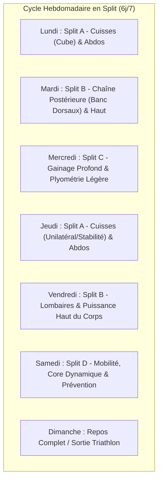
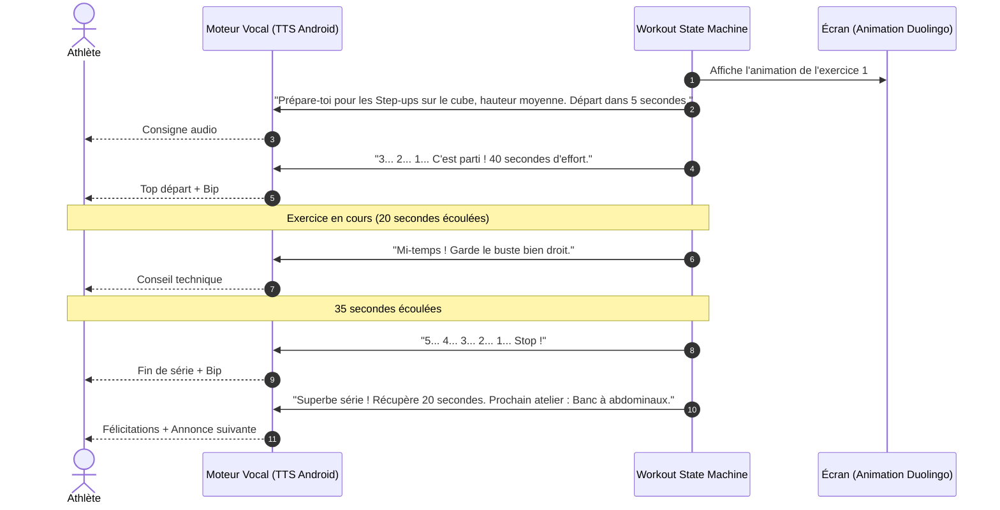
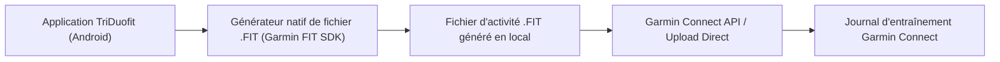
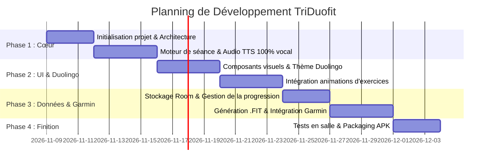

# Cahier des Charges & Spécifications Détaillées
## Projet : Coach Sportif Personnel Android ("TriDuofit")
*Version 1.1 — Validée avec contraintes spécifiques*

---

### 1. Synthèse du Projet & Vision

Application mobile **Android native (Kotlin & Jetpack Compose)** conçue comme un **coach interactif 100% mains-libres** pour un sportif de **58 ans (68 kg)**, triathlète, réalisant son renforcement musculaire dans sa salle personnelle.

**Piliers de l'application :**
- **100% Vocal & Mains-libres** : L'athlète pose son téléphone et s'entraîne sans jamais toucher l'écran. Décomptes, changements d'ateliers, consignes techniques de posture et encouragements dynamiques sont dictés par la voix.
- **Programmation en Split (6 séances / semaine)** : Alternance ciblée des chaînes musculaires (Membres inférieurs / Cube vs Chaîne postérieure / Banc dorsaux vs Core / Banc abdos) pour préserver la fraîcheur pour les sorties de triathlon (vélo, natation, course).
- **Univers graphique & Gamification Duolingo** : Interface ultra-dynamique, mascotte expressive, animations 2D joyeuses pour chaque mouvement, boucle de satisfaction (streaks, XP, sons festifs, confettis).
- **Intégration Garmin Connect** : Export automatique de la séance vers l'écosystème Garmin (via Garmin Connect API Développeur et/ou génération native de fichiers d'activité `.FIT`).

---

### 2. Matériel & Programmation Hebdomadaire en Split (6 Jours)

L'entraînement s'articule sur une rotation en **Split sur 6 jours (30 à 45 min / séance)** avec 1 jour de repos passif ou récupération active (dimanche).

#### Matériel Confirmé de la Salle Personnelle (Photos fournies) :
1. **Vélo Elliptique (NordicTrack)** : Échauffement dynamique complet cardio/articulaire sans aucun impact au sol (préservation maximale des genoux/tendons à 58 ans), et blocs de fractionné tempo.
2. **Plateau d'Équilibre (Wobble / Balance Board rouge)** : Proprioception, renforcement des tendons d'Achille, soléaires et stabilité des chevilles/genoux pour l'économie et la prévention des blessures en course à pied.
3. **Barres Parallèles Hautes (Dip Station)** : Dips triceps/pectoraux, tractions inversées (rowing australien pour le grand dorsal et la puissance du crawl en natation), et relevés de genoux suspendus pour les abdominaux profonds.
4. **Banc à Dorsaux / Lombaires (Hyperextensions à 45°)** : Renforcement de la chaîne postérieure, fixation de la colonne vertébrale pour maintenir sans douleur la position sur les prolongateurs en vélo de triathlon.
5. **Banc à Abdominaux Incliné (Rouge avec rouleaux de calage)** : Enroulements de buste déclinés, relevés de bassin inversés.
6. **Cube Plyométrique en Bois (Multi-hauteurs)** : Step-ups unilatéraux puissants, squats bulgares, fentes.

#### Répertoire d'exercices par atelier :
- **Atelier Vélo Elliptique** : Échauffement 60s à 3 min, fractionné tempo (cadence haute).
- **Atelier Plateau d'Équilibre** : Squats contrôlés sur plateau, planche avec mains sur plateau (gainage dynamique 3D).
- **Atelier Barres Parallèles** : Dips au poids de corps, tractions inversées horizontales (grand dorsal), relevés de genoux suspendus.
- **Atelier Banc à Dorsaux** : Hyperextensions lentes à 45°, maintien isométrique horizontal (40s).
- **Atelier Banc à Abdominaux** : Crunchs déclinés contrôlés, relevés de jambes / bassin inclinés.
- **Atelier Cube en Bois** : Step-ups tempo 3-0-1, squats bulgares (pied arrière sur le cube).

---

### 3. Moteur Vocal & Expérience Mains-Libres (100% Vocal)

Le sportif ne touche jamais son smartphone durant la séance :

#### Caractéristiques du système vocal & IA (OpenAI Whisper + TTS + Fallback Local) :
- **Reconnaissance & Écoute Permanente Continue (Mains-Libres Total)** :
  - L'application écoute en permanence via le micro, sans jamais s'arrêter ni nécessiter de toucher l'écran :
    - **« GO »** / **« C'est parti »** / **« Démarre »** : lance immédiatement l'exercice sans attendre le compte à rebours de 5s, ou relance la séance depuis une pause.
    - **« Mets en pause »** / **« Pause »** / **« Stop »** : fige le minuteur et met la séance ainsi que la musique techno en pause.
    - **« Reviens à zéro »** / **« Remets à zéro »** / **« Recommence »** : réinitialise immédiatement le chronomètre de la série en cours à sa durée totale (ex: 40s) avec annonce vocale : *"Chrono remis à zéro. 3, 2, 1, partez !"*.
    - **« Suivant »** / **« Passe »** : saute l'exercice ou passe directement à l'exercice d'après.
    - **« Répète »** / **« Conseil »** : réénonce le nom de l'exercice et la consigne technique de posture.
  - Robustesse : relance automatique instantanée de l'écoute en cas de silence ou de fin de phrase.
- **Moteur Vocal IA Haute Fidélité (OpenAI Audio Speech API - `tts-1` / `tts-1-hd`)** :
  - Voix humaines, expressives et naturelles avec modulation d'émotion (ex. voix `onyx` sportive/profonde ou `nova` dynamique/chaleureuse).
  - Élimine le ton robotique des synthèses classiques pour une immersion totale.
- **Cache Audio Intelligent (Local Disk Caching)** :
  - Les consignes audio générées par OpenAI (ex: décomptes, noms d'exercices, transitions) sont **sauvegardées localement en format `.mp3`** dans le stockage de l'app.
  - Résultat : aucune latence lors de la séance, zéro consommation répétée de tokens API, et fonctionnement fluide même sans réseau dans la salle.
- **Coaching Personnalisé Dynamique par LLM (GPT-4o-mini)** :
  - Génération de briefs motivationnels en début et fin de séance, prenant en compte le profil (triathlète 58 ans, 68 kg, séance du jour, série de jours consécutifs *streak*).
- **Mode Fallback Transparent (Hors-Ligne)** :
  - Si l'utilisateur n'a pas configuré de clé API OpenAI ou s'il n'y a pas de connexion Internet lors d'un message inédit, l'application bascule automatiquement sur le moteur natif Android (`android.speech.tts.TextToSpeech` et `SpeechRecognizer` Android natif).
- **Mix sonore intelligent (Audio Ducking) & Musique Techno High-BPM** :
  - **Bande-son Techno intégrée (130 à 145 BPM)** : boucles électro rythmées et motivantes en fond sonore pour rythmer la cadence et dynamiser l'effort.
  - **Audio Ducking automatisé** : dès que le coach IA OpenAI ou le décompte vocal intervient, la musique techno baisse automatiquement à 20-30% du volume, puis remonte progressivement à son niveau dès que la consigne est terminée.
  - **Contrôles dédiés** : sélecteur de rythme (130 / 140 BPM), curseur de volume musique vs voix, et bouton "Mute musique intégrée" si l'athlète préfère diffuser sa propre playlist Spotify/Deezer en arrière-plan (l'application applique alors l'Audio Ducking système standard `AudioFocusRequest`).
- **Gestion sécurisée de la clé API** : Écran dédié dans les réglages permettant de saisir sa propre clé API OpenAI (stockage chiffré via `EncryptedSharedPreferences`).

---

### 4. Direction Artistique & Style "Duolingo"

- **Mascotte animée (La Mouette Triathlète)** :
  - Mascotte officielle : **Une mouette triathlète énergique** (inspirée de la mascotte d'Andernos Triathlon).
  - Éléments graphiques distinctifs : lunettes de natation / triathlon bleues relevées sur le front, grand bec orange courbé et crochu, maillot trifonction orange athlétique, plumage blanc et ailes bleu marine.
  - Émotions réactives (Jetpack Compose Canvas animé) :
    - *Idle* : respiration douce et posture détendue.
    - *Working Out* : concentration sportive et goutte de sueur dynamique.
    - *Cheering* : battements d'ailes et bec ouvert d'encouragement.
    - *Celebrating* : sauts de joie, yeux rieurs et étoiles dorées de victoire.
- **Composants UI 3D doux (Neobrutalism accessible)** :
  - Boutons avec effet de relief / bordure inférieure contrastée (simulation de clic mécanique).
  - Couleurs dominantes : Vert Duolingo (`#58CC02`), Orange Feu (`#FF9600`), Bleu Course (`#1CB0F6`), Rouge Cœur (`#FF4B4B`).
- **Animations des mouvements** :
  - Rendu vectoriel léger en **Lottie** ou **Compose Canvas**.
  - Style cartoon épuré montrant clairement la trajectoire et le placement du dos.
- **Système de récompense instantanée** :
  - Fanfare sonore et pluie de confettis en fin de séance.
  - Progression sur la carte du monde / sentier de progression avec verrouillage/déverrouillage des séances.
  - Incrémentation du compteur de *Streak* (flamme de régularité).

---

### 5. Intégration Écosystème Garmin (Compte Développeur)

En tant que triathlète disposant d'un **compte développeur Garmin**, l'application exploite deux canaux d'intégration :

1. **Génération native de fichiers `.FIT` (Flexible and Interoperable Data Transfer)** :
   - Utilisation de la bibliothèque officielle **Garmin FIT SDK (Java/Kotlin)**.
   - Encodage précis de l'activité avec le type de sport : `FIT_SPORT_TRAINING` / sous-sport `STRENGTH_TRAINING`.
   - Enregistrement de la durée totale, des calories estimées, du détail des séries, des temps d'effort et des temps de repos.
2. **Synchronisation Garmin Connect** :
   - Push via l'API REST **Garmin Connect Activity Upload** (OAuth 1.0a / OAuth 2.0 avec les identifiants développeur Garmin).
   - Option alternative directe : Partage / export vers l'application locale *Garmin Connect Mobile* installée sur le téléphone.

---

### 6. Architecture Technique Android

- **Langage** : Kotlin 2.0+
- **Interface** : Jetpack Compose + Material3
- **Audio & Voix** : `android.speech.tts.TextToSpeech` + `SoundPool` + gestion des `AudioFocusRequest` (Audio Ducking)
- **Persistance** : Room Database (programmes, historique, séries, paramètres utilisateur)
- **Background Engine** : Service Android en avant-plan (`ForegroundService` avec notification persistante) assurant le décompte précis même si l'écran s'éteint ou si une autre application passe au premier plan
- **Format d'export** : `com.garmin:fit` (Garmin FIT SDK)

---

### 7. Feuille de Route de Développement

